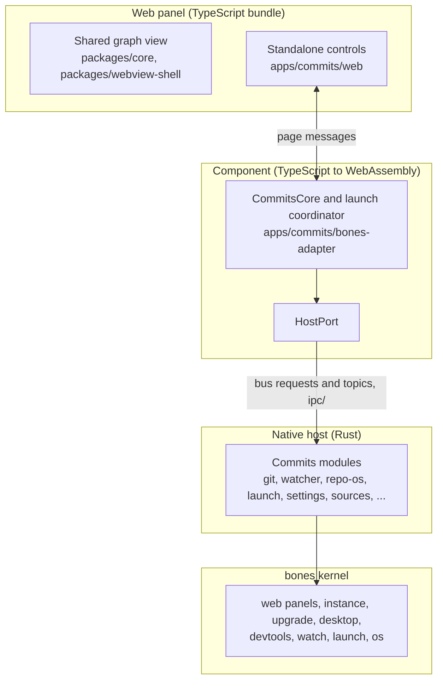

# Architecture

Commits is a desktop Git client built on the [bones](../vendor/bones/README.md) engine. Its product logic is the `an-dr-commits` VS Code extension's core, compiled from TypeScript to a WebAssembly component that bones loads; its interface is that extension's web view, shown in a bones web panel. The same core is meant to serve both the desktop app and the extension, so only a thin host port differs between them.

## Layers



Dependencies point inward. The page and the native host both talk to the component through messages; the component reaches native work only through `HostPort`, whose bones implementation is `BonesHostPort`.

## Boundaries

| Concern | Lives in | Reason |
| --- | --- | --- |
| Running `git` | native `git` module | A WebAssembly guest cannot spawn processes |
| Parsing Git output, repository behaviour | component | It is the ported product logic, shared with the extension |
| Watching repository files | native `watcher` module over bones watch | Needs OS watch APIs and threads |
| Clipboard, URLs, file pickers, HTTPS | bones `os` module | Generic desktop surface; nothing about it needs a repository ([ADR-012](adr/ADR-012-generic-capabilities-belong-upstream.md)) |
| Repository-scoped reads, scans, external tools, askpass | native `repo-os` module | Only meaningful inside a repository |
| Updates, desktop registration, single instance, control channel | bones services, configured by the host | Generic, so owned upstream |
| Graph, table, diffs, dialogs | shared web view | Reused from the extension unchanged except where [shared core](shared-core.md) says |
| Health button, source sections, notices, session themes | `apps/commits/web` | Standalone-only; extends the shared view through a declared markup contract |

`vendor/bones` is read-only upstream ([ADR-003](adr/ADR-003-treat-vendored-bones-as-read-only-upstream.md)); anything Commits needs there is contributed upstream and reaches this repository through the submodule pin.

## Native endpoints

| Endpoint | Module | Answers |
| --- | --- | --- |
| `git` | `crates/git` | Correlated Git runs on `git/request` and `git/completed` |
| `watcher` | `crates/watcher` | Repository change events on `repo/*` topics |
| `repo-os` | `crates/os` | Repository-scoped file reads, scans, and tool launches |
| `launch` | `host/src/launch.rs` | The startup launch request; handoffs arrive on `launch/request` |
| `repository-state` | `host/src/repository_state.rs` | Whether a path exists, is a repository, and which operation is in progress |
| `sources` | `host/src/sources.rs` | [Repository source](repository-sources.md) lists |
| `installation` | `host/src/installation.rs` | Installed, registered, and version status |
| `settings` | `host/src/settings.rs` | Raw [settings](settings.md) document reads and atomic writes |
| `commits-repo` | `host/src/commits_repo.rs` | Status of the `~/.commits/repo` clone |
| `page`, `splash` | `host/src/page.rs`, `host/src/splash.rs` | The local page server for the web panels |

Every message format both sides must agree on lives in `ipc/`, with Rust-generated fixtures that the TypeScript tests read ([ADR-002](adr/ADR-002-keep-one-wire-contract-with-cross-language-fixtures.md)).

## How the component runs the shared view

The component runs the shared web view without its Node-only Git backend:

- `CommitsCoreWorkspacePort` implements the shared `WorkspacePort` over repository paths the host supplies, and `RepositoryManager` discovers repositories through it.
- `MitGraphBackend` maps graph reads to bounded native Git requests and returns the shared request and response models.
- `packages/webview-shell` holds the host-independent page shell, localization, and upstream CSS; the page calls the shared `startCommitsView()` directly.

The shared package's uses of `simple-git` and Node's `fs`, `path`, and `child_process` are not compiled into the component.

## Repository layout

```text
apps/commits/
  host/            Rust composition root: bones plus the Commits modules
  bones-adapter/   TypeScript component, built to commits.wasm
  web/             TypeScript page around the shared web view
  scripts/         page, bundle, and component builds
crates/            native git, watcher, and repo-os modules
ipc/               wire contract shared by Rust and TypeScript, with fixtures
packages/          MIT code shared with the VS Code extension
vendor/bones/      upstream engine submodule, read-only
docs/              human documentation; docs/adr/ holds decisions
```
